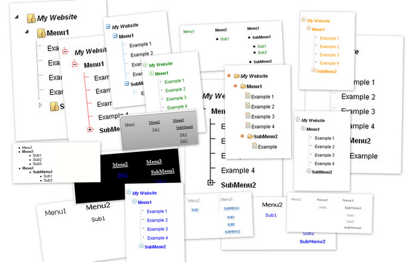

<p align="center">
  <picture>
    <source media="(prefers-color-scheme: dark)" srcset="Source/Resources/SiteMap-dark.png" />
    <source media="(prefers-color-scheme: light)" srcset="Source/Resources/SiteMap.png" />
    
  </picture>
</p>

<p align="center">
  A modern SiteMap / TreeView <b>Module</b> and <b>Skin Object</b> for DNN®
</p>

<p align="center">
  <a href="https://github.com/w8tcha/dnnsitemapui/releases/latest"></a>
  <a href="https://github.com/w8tcha/dnnsitemapui/releases"></a>
  
  <a href="LICENSE.md"></a>
</p>

---



## About

Back in the old days, almost every website had a sitemap page listing all of its pages, helping visitors and search engine spiders find their way around. Many modern websites have dropped that page and place the sitemap in the footer instead.

**SiteMap** renders exactly that kind of footer-style sitemap – but you can place it anywhere on your site, either as a module or directly in your theme as a skin object. It ships with a range of skins and can also render the sitemap as an animated, collapsible **TreeView**.

## Features

- Available as **Module** and as **Skin Object**
- Lightweight
- Two render modes: **Normal** and **TreeView**
- 19 built-in skins (9 normal, 10 TreeView)
- Shows only the pages the visitor is permitted to see
- Configurable start level and maximum number of sublevels
- Option to show only the sub-links of the current page
- Easily exclude (or include) specific pages by ID
- Show / hide hidden pages
- Show / hide page icons, with an optional default icon
- Filter pages by taxonomy tags
- Human-friendly URLs
- Full localization support
- `IPortable` support (import / export of module settings)
- Demo mode with a skin selector shown above the sitemap

## Requirements

- DNN Platform **10.4.1** or later

## Installation

1. Download the latest install package from the [Releases](https://github.com/w8tcha/dnnsitemapui/releases) page.
2. In DNN, go to **Settings → Extensions → Install Extension** and upload the package.
3. Add the **SiteMap** module to a page, or use the skin object in your theme (see below).

## Configuration

### Start level

| Option     | Description |
|------------|-------------|
| `Root`     | Shows all pages. |
| `Parent`   | Shows all pages starting from the parent level of the current page. Falls back to root if there is no parent. |
| `Current`  | Shows all pages on the current page's level. |
| `Children` | Shows all child pages of the current page. Falls back to root if there are no children. |
| `Custom`   | Shows all pages on the level of the selected page. |

### TreeView options

| Option      | Description |
|-------------|-------------|
| `Animation` | Expand / collapse animation speed: `slow`, `normal` or `fast`. |
| `Collapse`  | Whether all nodes are collapsed by default. |
| `Unique`    | Only one node can be open at a time; opening a node collapses the others. |
| `Persist`   | How the expand / collapse state is kept:<br>• `location` – expands the node (and its parents) whose link matches the current URL<br>• `cookie` – saves the state in a cookie on each click and restores it on page load |

### Taxonomy filter

Pages can be filtered by taxonomy terms from:

- the current page
- all vocabularies
- selected vocabularies
- selected terms

## Using the Skin Object

Register the skin object in your theme:

```aspx
<%@ Register TagPrefix="dnn" TagName="SITEMAP" Src="~/DesktopModules/SiteMap/SiteMapSl.ascx" %>
```

Then place it wherever you want the sitemap to appear, for example in the footer:

```aspx
<dnn:SITEMAP runat="server" id="dnnSiteMap" SkinName="Default" RenderMode="normal" RootLevel="root" MaxLevel="2" />
```

### Skin Object properties

| Property          | Default    | Description |
|-------------------|------------|-------------|
| `SkinName`        | `Default`  | Name of the skin to use. |
| `RenderMode`      | `normal`   | `normal` or `treeview`. |
| `RootLevel`       | `root`     | `root`, `parent`, `current`, `children` or `custom`. |
| `RootTab`         | `-1`       | Page ID to start from when `RootLevel` is `custom`. |
| `MaxLevel`        | `-1`       | Maximum number of sublevels (`-1` = unlimited). |
| `ExclusionTabs`   | *(empty)*  | Comma-separated list of page IDs to exclude. |
| `InclusionTabs`   | *(empty)*  | Comma-separated list of page IDs to include. |
| `ShowHidden`      | `false`    | Show pages that are hidden from the menu. |
| `ShowTabIcons`    | `false`    | Show page icons. |
| `DefaultIcon`     | *(empty)*  | Icon to use for pages without an icon. |
| `HumanUrls`       | `false`    | Generate human-friendly URLs. |
| `RenderName`      | `false`    | Render the root name in TreeView mode. |
| `Animated`        | `normal`   | TreeView animation speed: `slow`, `normal` or `fast`. |
| `Collapsed`       | `true`     | TreeView: collapse all nodes by default. |
| `Unique`          | `true`     | TreeView: allow only one open node at a time. |
| `Persist`         | `location` | TreeView: `location` or `cookie`. |
| `FilterByTax`     | `false`    | Enable filtering by taxonomy. |
| `TaxMode`         | `all`      | `tab`, `all`, `custom` (vocabularies) or `terms`. |
| `TaxVocabularies` | *(empty)*  | Comma-separated vocabulary IDs (for `TaxMode="custom"`). |
| `TaxTerms`        | *(empty)*  | Comma-separated term names (for `TaxMode="terms"`). |
| `DemoMode`        | `false`    | Show the skin selector above the sitemap. |

## Building from source

Requires Visual Studio (or MSBuild) with .NET Framework 4.8.1.

```powershell
nuget restore SiteMap.slnx
msbuild Source/SiteMap.csproj /p:Configuration=Deploy /p:Platform=AnyCPU
```

The install packages are written to the `deploy` folder.

## License

Copyright © Ingo Herbote. Released under a BSD-style license – see [LICENSE.md](LICENSE.md).
